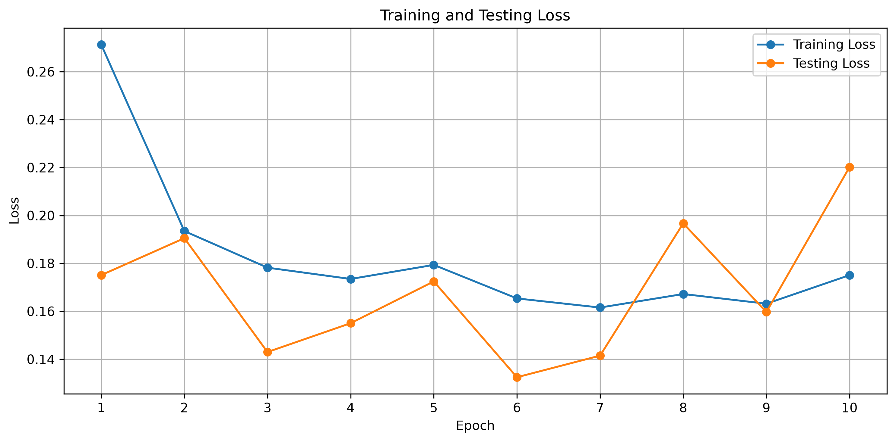
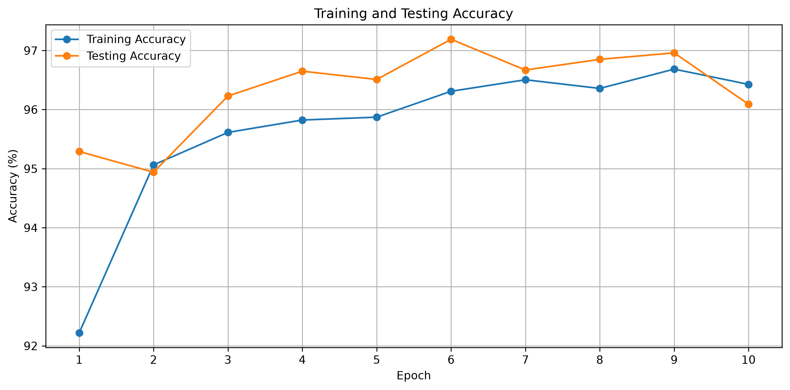
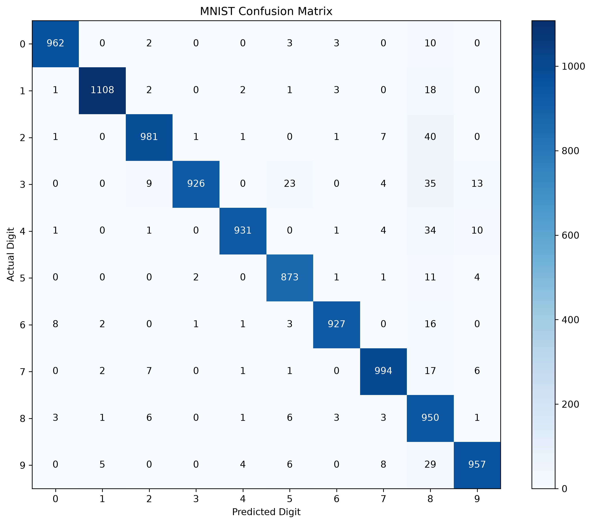
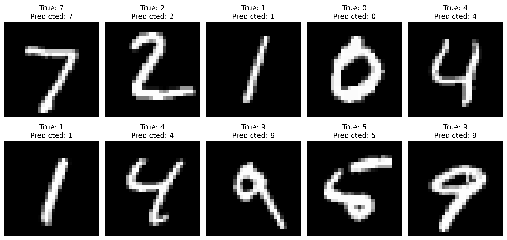

# MNIST Handwritten Digit Classification Using CNNs

A Convolutional Neural Network (CNN) built with PyTorch to classify handwritten digits from the MNIST dataset. This project explores the fundamentals of deep learning, including convolutional layers, feature extraction, backpropagation, loss functions, and model evaluation.

## Project Overview

The goal of this project was to build and train a CNN that can recognize handwritten digits from **0 to 9** using the MNIST dataset.

I implemented the model using PyTorch and trained it for **10 epochs**, monitoring training loss, testing loss, and classification accuracy to understand how the network learns over time.

## Technologies Used

- **Python** for programming
- **PyTorch** for building and training the neural network
- **Torchvision** for loading the MNIST dataset and transforming images
- **Matplotlib** for visualizing training results
- **NumPy** for numerical operations
- **Scikit-learn** for generating the confusion matrix

## Model Architecture

The CNN consists of two convolutional layers followed by three fully connected layers.

| Layer | Configuration | Purpose |
|---|---|---|
| Input | 28 × 28 grayscale image | Receives handwritten digits |
| Convolution 1 | 1 → 6 channels, 3 × 3 kernel | Extracts basic visual features |
| ReLU + Max Pooling | 2 × 2 pooling | Introduces non-linearity and reduces dimensions |
| Convolution 2 | 6 → 16 channels, 3 × 3 kernel | Extracts more complex features |
| ReLU + Max Pooling | 2 × 2 pooling | Further reduces spatial dimensions |
| Flatten | 400 features | Converts feature maps into a vector |
| Fully Connected 1 | 400 → 120 neurons | Learns feature combinations |
| Fully Connected 2 | 120 → 84 neurons | Learns higher-level representations |
| Output | 84 → 10 neurons | Produces scores for digits 0–9 |

ReLU activation functions are used in the hidden layers, while Cross Entropy Loss measures prediction error.

## Training Configuration

| Parameter | Value |
|---|---|
| Dataset | MNIST |
| Training images | 60,000 |
| Testing images | 10,000 |
| Image dimensions | 28 × 28 pixels |
| Batch size | 10 |
| Epochs | 10 |
| Optimizer | Adam |
| Learning rate | 0.01 |
| Loss function | Cross Entropy Loss |
| Output classes | 10 |

## Training Results

The model was trained for 10 epochs. Training and testing metrics were recorded to evaluate its learning progress and performance on unseen test images.

### Training and Testing Loss

Loss measures how far the model's predictions are from the correct labels. Tracking both training and testing loss helps assess whether the model is learning and whether it may be overfitting.



### Training and Testing Accuracy

Accuracy measures the percentage of images classified correctly. Comparing training accuracy with testing accuracy helps evaluate how well the model generalizes beyond its training data.



### Confusion Matrix

The confusion matrix compares actual digit labels against predicted labels across the 10,000 test images. Values along the diagonal represent correct predictions, while off-diagonal values show misclassifications.



### Sample Predictions

The following visualization shows handwritten digit images alongside their actual labels and the CNN's predicted labels.



## Key Concepts Practiced

- Building a CNN using `torch.nn.Module`
- Applying convolution, ReLU activation, and max pooling
- Flattening feature maps before fully connected layers
- Using forward propagation to generate predictions
- Calculating classification loss with `nn.CrossEntropyLoss()`
- Applying backpropagation with `loss.backward()`
- Updating model parameters using the Adam optimizer
- Evaluating performance with training and testing accuracy
- Using `model.train()`, `model.eval()`, and `torch.no_grad()`
- Analyzing classification errors with a confusion matrix

## Running the Project

### 1. Clone the repository

```bash
git clone YOUR_REPOSITORY_URL
cd YOUR_PROJECT_FOLDER
```

### 2. Install dependencies

```bash
pip install torch torchvision numpy pandas scikit-learn matplotlib
```

### 3. Run the model

```bash
python mnist_cnn.py
```

The MNIST dataset will be downloaded automatically when necessary. Training results will be printed in the terminal, and the saved visualizations can be viewed directly in the project folder.

## What I Learned

Through this project, I gained practical experience building and training a convolutional neural network with PyTorch. I explored how neural networks extract visual features, calculate prediction errors, and update their parameters through backpropagation.

Training the model over multiple epochs also helped me understand the importance of monitoring loss and accuracy and evaluating performance on data the model was not trained on.

## Future Improvements

- Experiment with different learning rates and batch sizes.
- Compare Adam with SGD.
- Improve the model architecture and evaluate its effect on accuracy.
- Investigate misclassified digits using the confusion matrix.
- Save and reload trained model weights for inference.
- Test the model on handwritten digits outside the MNIST dataset.

---

**Built with Python and PyTorch.**
